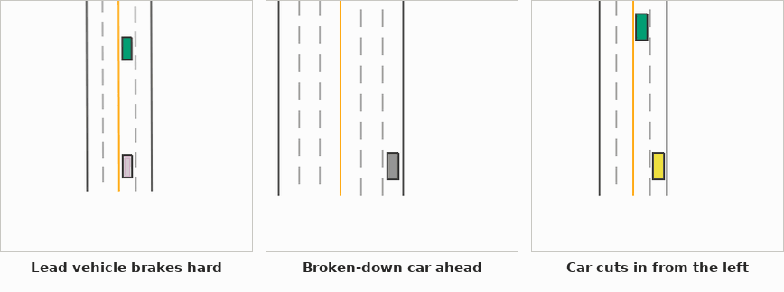
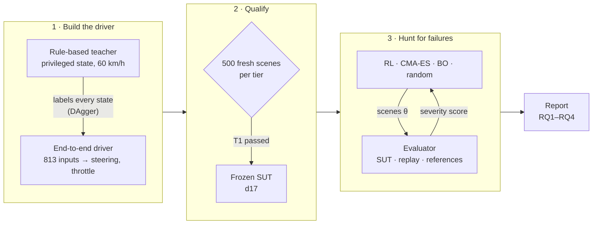
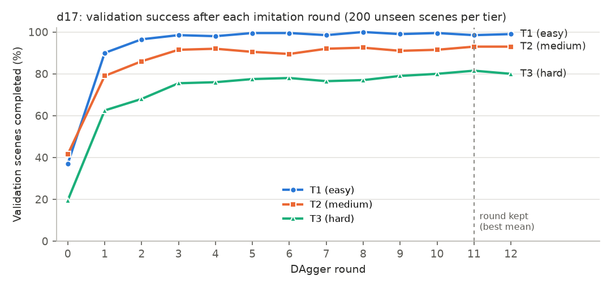
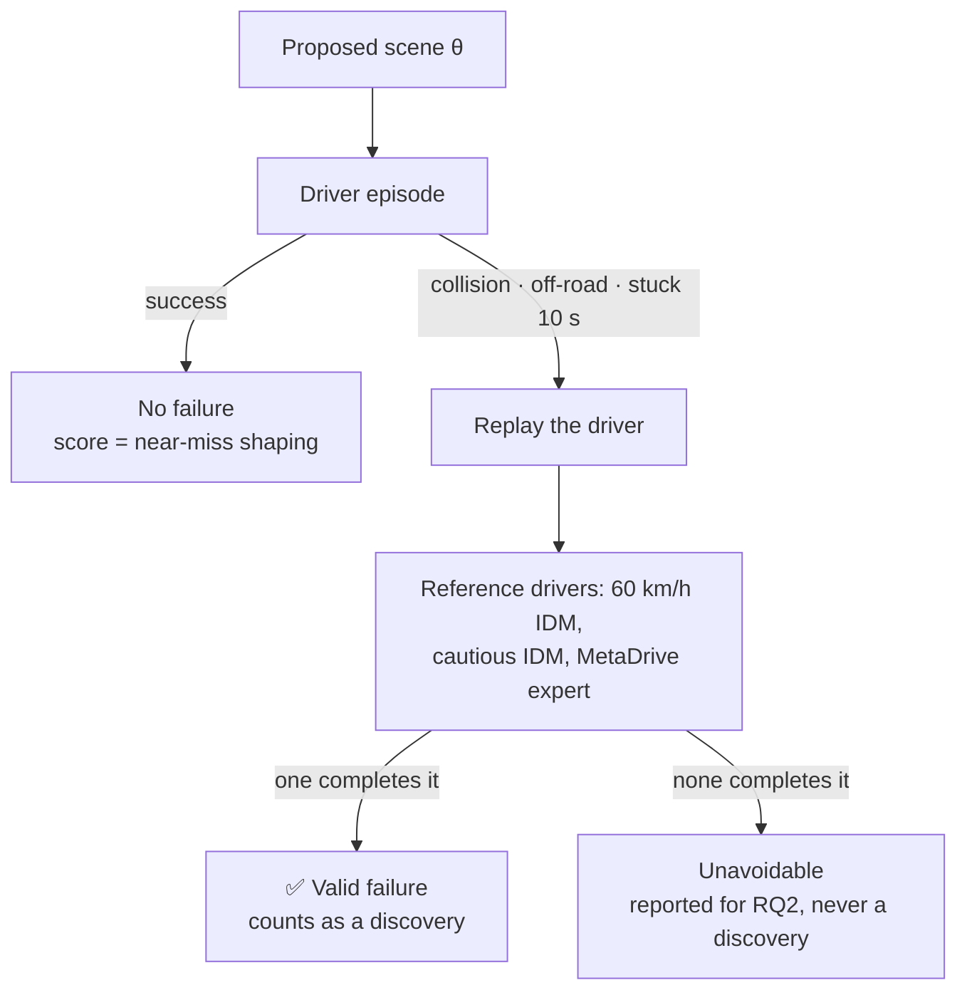

<div align="center">

# Adversarial Testing of a Learned Driving Policy

**Can a reinforcement-learning adversary find the failures that random testing misses?**

[](https://www.python.org/)
[](https://pytorch.org/)
[](https://github.com/metadriverse/metadrive)
[](docs/QUALIFICATION.md)
[](docs/RUNBOOK.md)



<sub>The frozen driver <b>d17</b> on its three showcase scenes, seen from above at 2× speed. In each panel our car is the box in the lower middle, driving up the page.</sub>

</div>

<br>

<div align="center">

| **1.47 M** | **99.4 %** | **0.4 %** | **4 × 10 × 1,000** |
|:---:|:---:|:---:|:---:|
| parameters in the end-to-end driver | success on 496 held-out T1 scenes | crash rate on those scenes | search methods × seeds × evaluations |

</div>

---

## Overview

A learned driving policy can pass a random-testing exam and still have failures that random testing rarely hits. This capstone project measures **how efficiently different search methods find those failures**:

- a **reinforcement-learning scenario generator** (the contribution);
- **CMA-ES** and **Bayesian optimisation**, two black-box optimisers;
- **uniform random search**.

All four get exactly the same simulator budget.

The system under test is an **end-to-end neural driver** that reads 813 sensor values ten times per second and outputs steering and throttle/brake, with no hand-written rules in between. It was trained in [MetaDrive](https://github.com/metadriverse/metadrive) by imitating a privileged rule-based teacher, then frozen after passing a strict, preregistered qualification gate.

Only **valid failures** count. A valid failure:
- is inside the driver's operational design domain (ODD);
- is physically plausible by construction;
- is avoidable: an independent reference driver completes the same scene;
- repeats exactly on replay.

> [!NOTE]
> The driver is the *test subject*, not the contribution. It has to be good, so that failures are rare under random testing and the comparison between search methods means something.

## Contents

- [Research questions](#research-questions)
- [How it works](#how-it-works)
- [Results so far](#results-so-far)
- [Getting started](#getting-started)
- [Repository layout](#repository-layout)
- [Documentation](#documentation)
- [Acknowledgements](#acknowledgements)

## Research questions

| | Question | Primary measure |
|---|---|---|
| **RQ1** | **Efficiency.** At an equal number of driver evaluations, does the RL adversary find more unique valid failures than CMA-ES, BO and random? | unique valid failures per 1,000 evaluations |
| **RQ2** | **Validity.** What share of each method's failures is unavoidable (no reference driver completes the scene)? | invalid-failure fraction |
| **RQ3** | **Diversity.** How many distinct failure modes does each method find? | failure clusters and parameter-grid coverage |
| **RQ4** | **Generalisation.** Does the frozen RL generator keep its advantage on road layouts it never saw? | RL vs random on held-out map seeds |

No direction is assumed; negative or inconclusive answers are reported as such ([design](docs/DESIGN.md)).

## How it works



### 1 · Scenario space

Every scene is a vector **θ ∈ [0, 1]¹²** plus a map seed, decoded into one MetaDrive episode:
- three road pieces;
- 2–3 lanes, 3–4 m wide;
- background traffic;
- one scripted event: a **lead car braking hard**, a **broken-down car**, or a **cut-in**, with its timing, distance and intensity.

Ranges are bounded to plausible values, so no scene needs filtering afterwards ([parameters](docs/SCENARIO_SPACE.md)).

| Tier | Road pieces | Traffic density | Events |
|---|---|---|---|
| **T1** | straight, curve | 0 – 0.10 | lead brake, obstacle |
| **T2** | + on/off-ramps | 0 – 0.15 | + cut-in |
| **T3** | + crossroads, T-junctions, roundabouts | 0 – 0.20 | all three |

### 2 · The driver

<details>
<summary><b>Inputs, network and training</b> (click to expand)</summary>
<br>

**Inputs: 813 values in [0, 1], plus their change over the last 0.2 s.**
- 720-beam lidar (100 m);
- 24-beam road-edge and 24-beam lane-line detectors;
- the 4 nearest vehicles;
- navigation;
- ego state;
- a 13-value lane model: the lane centre up to 40 m ahead, the lane width and the neighbouring lanes, as a lane-detection camera reports it.

**Network.**
- A 3 × 512 SiLU trunk with two heads:
  - **lane intent** (left / keep / right);
  - **throttle/brake** as one of 9 levels.
- A separate 2 × 256 **steering** network on the 77 ego and lane values, with one steering output per intent.
- 1,470,735 parameters. The outputs drive the car directly.

**Teacher.**
- MetaDrive's IDM at a 60 km/h cruise, passing stopped objects.
- PD steering along the route.
- Emergency braking below 2.5 s to collision, and predictive braking for vehicles crossing its path within 3 s.
- It reads the true map and every vehicle's exact state. The student never does.

**Training: DAgger imitation.**
- 13 rounds of 600 episodes over all three tiers. The teacher drives round 0; the student drives a growing share after that, and the teacher labels every state either way.
- 1.4 M aggregated samples, 20 epochs per round.
- The round with the best validation over 200 unseen scenes per tier is kept: round 11.
- 11.6 h on a laptop CPU.

Also tried and documented in the [log](docs/LOG.md): PPO driver training, a planner over a PID controller, an object-list input, a holding-brake teacher, and PPO fine-tuning of the end-to-end network.
</details>

<p align="center"></p>

### 3 · Qualification gate

The gate was preregistered before any training. Each attempt draws **500 fresh scenes per tier** from a map pool reserved for exams. The scene list is fingerprinted before the first episode, and each tier is tried hardest first: **T3 → T2 → T1**. The first tier passed becomes the ODD, and the driver file is frozen by its hash.

| Pass condition | Threshold |
|---|---|
| success on scenes some reference driver completes | ≥ 98 % |
| 95 % Wilson lower bound on that success rate | ≥ 0.96 |
| collision or off-road rate | ≤ 2 % |

### 4 · Search methods: equal budget, shared objective

| Method | How it proposes scenes | Settings |
|---|---|---|
| **Random** | uniform θ: exactly the qualification distribution | none |
| **CMA-ES** | evolution strategy on the severity score | population 12, σ₀ = 0.3, restarts on stagnation |
| **Bayesian optimisation** | Gaussian process + expected improvement | Matérn 5/2, 20 initial points, ≤ 400 points, kriging-believer batches |
| **RL adversary** ⭐ | PPO generator conditioned on coverage and search history | reward: severity + novelty bonus − penalty for unavoidable scenes |

All four maximise the same **bounded severity score**: 1 for a valid failure, otherwise near-miss shaping from the minimum time-to-collision and route completion. One evaluation is one episode of the driver. Each method gets **1,000 evaluations per run** and **10 seeds**.

### 5 · What counts as a failure



Every episode starts from an identical simulator state (environment v3), so a replay repeats its episode exactly and a failure never depends on what ran before it.

## Results so far

### Qualification: attempt 3, 10 November 2026

| Tier | Solvable scenes | Success | Wilson 95 % LB | Crash rate | Verdict |
|---|---:|---:|---:|---:|:---:|
| T3 (hard) | 382 | 90.1 % | 0.866 | 8.9 % | ❌ |
| T2 (medium) | 455 | 96.7 % | 0.946 | 3.3 % | ❌ |
| **T1 (easy)** | **496** | **99.4 %** | **0.982** | **0.4 %** | ✅ **ODD** |

Each tier's exam score is within a point of its score on the development panels, so the development scenes predicted the real exam well. Full history: [QUALIFICATION.md](docs/QUALIFICATION.md).

### Adversarial search

> [!IMPORTANT]
> The 40 search runs (4 methods × 10 seeds) have not been run yet. Timing on T1 measured about 70 minutes per seed for all four methods. Results will be written to `reports/RESULTS.md` by `scripts.report`, rebuilt from the per-episode logs.

## Getting started

**Requirements:** Windows, Python 3.11, CPU only. The numbers above were measured on an Intel i7-11370H laptop (4 cores) with 16 GB of RAM.

```powershell
git clone https://github.com/CrimsonAzul/adversarial-av-testing.git
cd adversarial-av-testing
py -3.11 -m venv .venv
.\.venv\Scripts\python.exe -m pip install torch --index-url https://download.pytorch.org/whl/cpu
.\.venv\Scripts\python.exe -m pip install -r requirements.lock.txt
.\.venv\Scripts\python.exe -m pytest -q          # 80 tests, including real-simulator replay tests
```

**Pipeline commands:**

```powershell
# 1. train the driver (DAgger imitation, ~12 h)
.\.venv\Scripts\python.exe -m scripts.pretrain_bc --name d17 --tier all --controller yield_pd --action e2e --rounds 12 --brake-weight 3

# 2. qualification gate: T3 → T2 → T1, freezes the first tier passed
.\.venv\Scripts\python.exe -m scripts.qualify --model runs\driver\d17\model_best_bc.zip --attempt 3 --workers 8

# 3. search runs for RQ1–RQ3 (all methods × seeds, resumable sessions)
.\.venv\Scripts\python.exe -m scripts.run_search --hours 8

# 4. RQ4 and the report
.\.venv\Scripts\python.exe -m scripts.rq4
.\.venv\Scripts\python.exe -m scripts.report
```

Every long job resumes when you run the same command again. Create a `PAUSE` file in its output folder to stop at the next safe point, or `STOP` to stop at once. Step-by-step notes are in the [runbook](docs/RUNBOOK.md).

> [!NOTE]
> Model files (`*.zip`) are not stored in the repository. The frozen driver's SHA-256 and settings are in [`models/QUALIFIED.json`](models/QUALIFIED.json), and every search run checks `models/sut.zip` against them before it starts.

## Repository layout

```text
avtest/
├── scenario.py      θ ∈ [0,1]^12 → MetaDrive scene (roads, lanes, traffic, one scripted event)
├── sim.py           environment: events, lane model, telemetry, outcomes (v3: repeatable episodes)
├── policy.py        the driver's network (EndToEndModel), frame history and imitation fit
├── tactical.py      the teacher and its controller (PD steering, emergency and predictive braking)
├── drivers.py       the frozen SUT and the reference drivers (60 km/h IDM, cautious IDM, expert)
├── evaluate.py      parallel evaluator: SUT episode, replay, references → one record per scene
├── severity.py      the shared objective every search method maximises
├── adversaries/     random · CMA-ES · Bayesian optimisation · RL (PPO scenario generator)
├── search.py        resumable search run with an exact evaluation budget
├── stats.py         discovery curves, unique failure cells, bootstrap and Wilson intervals
├── recording.py     top-down GIF and keyframe recordings
├── seeds.py         disjoint map-seed splits: training, validation, qualification, search, held-out
├── records.py       append-only episode records, hashes and control files
├── finetune.py      PPO fine-tuning of the driver (tried, not adopted)
└── progress.py      validation panel, showcase recordings, progress charts
scripts/             pretrain_bc · qualify · run_search · rq4 · report · evaluate_controller ·
                     watch_driver · inspect_scenario · calibrate_references · train_driver · finetune_rl
tests/               80 tests: seeds, scenario decoding, severity and statistics; real-simulator episodes
                     and replays; the driver's network and training; search ledgers, pause and resume
docs/                design, scenario space, runbook, decision log, qualification record
```

## Documentation

| Document | What it covers |
|---|---|
| [DESIGN.md](docs/DESIGN.md) | thesis claim, research questions, ODD, qualification gate, driver, search methods, statistics, integrity rules |
| [SCENARIO_SPACE.md](docs/SCENARIO_SPACE.md) | the 12 scene parameters, their ranges and the outcome definitions |
| [RUNBOOK.md](docs/RUNBOOK.md) | what to run, in which order, and how long it takes |
| [LOG.md](docs/LOG.md) | dated decision log: every run, result and change, including what did not work |
| [QUALIFICATION.md](docs/QUALIFICATION.md) | every qualification attempt and verdict |

## Acknowledgements

- [MetaDrive](https://github.com/metadriverse/metadrive): the driving simulator, its IDM traffic and its bundled expert driver.
- [Stable-Baselines3](https://github.com/DLR-RM/stable-baselines3): PPO for the RL scenario generator.
- [pycma](https://github.com/CMA-ES/pycma) and [scikit-learn](https://scikit-learn.org/): CMA-ES and the Gaussian process behind Bayesian optimisation.

<sub>Simulator outcomes do not establish real-world safety.</sub>
